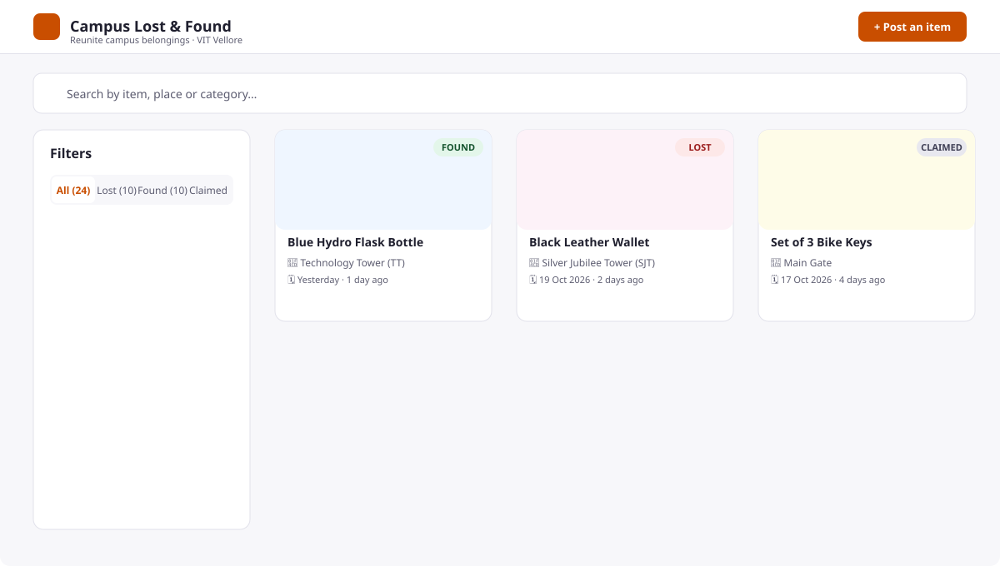
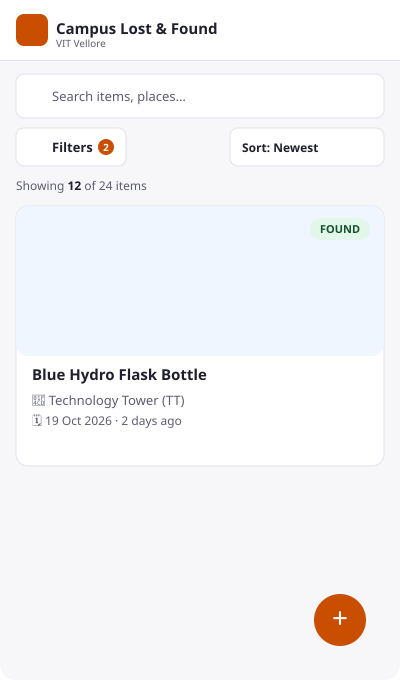
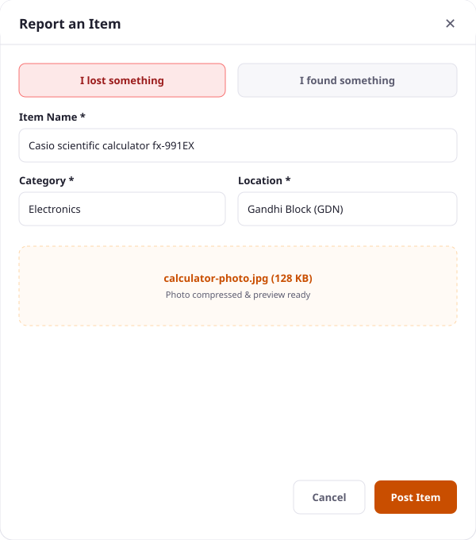
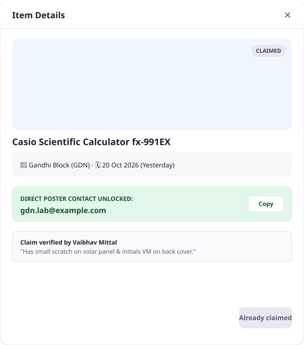

# 🎒 Campus Lost & Found

A responsive lost-and-found interface for VIT Vellore campus: post lost/found items, search, filter, sort, and claim them. Built as my Frontend task for the **Mozilla Firefox Club (VIT Vellore) recruitment**, Frontend subdomain.

**🔗 Live Demo:** [https://vaibhavmittal29.github.io/campus-lost-and-found/](https://vaibhavmittal29.github.io/campus-lost-and-found/)  
**📦 Repository:** [https://github.com/vaibhavmittal29/campus-lost-and-found](https://github.com/vaibhavmittal29/campus-lost-and-found)

---

## Screenshots

| Desktop View | Mobile Drawer View |
| :---: | :---: |
|  |  |

| Post Item with Image Compression | Item Detail & Claim Verification |
| :---: | :---: |
|  |  |

---

## Features

### Core Requirements
- **Item Cards:** Responsive presentation cards featuring category-colored image placeholders, two-line clamped titles, category badges, location pinpoints, relative dates, and status indicators.
- **Search:** Case-insensitive search supporting multi-word AND queries across item names, detailed descriptions, categories, and campus building names.
- **Filters:** Instant filtering by Status (`Lost`, `Found`, `Claimed`), Category (chips with icons and counts), and Campus Location.
- **Post Item Form:** Multi-field modal form reporting lost and found items with instant client-side photo resizing and validated submission.
- **Claim Items:** Ownership verification flow protecting poster contact info until a claim is submitted, after which direct contact details are revealed with a one-click clipboard copy tool.
- **Data Persistence:** Mock data layer backed by seed JSON and browser `localStorage`, with simulated latency (600–900ms) for realistic loading demonstrations.

### Extra Touches & Polish
- **Debounced Search (300ms):** Delays item re-filtering until the student pauses typing, keeping keystroke input silky smooth.
- **Sorting Modes:** Sort by `Newest first`, `Oldest first`, `Nearest campus location` (Euclidean distance on a 0–100 grid relative to chosen building), and `Best match` (relevance-weighted keyword scoring).
- **Client-Side Image Resizer:** Downscales uploaded camera photos into lightweight JPEG data URLs (`≤ 120 KB`) before storing, avoiding browser storage quota exhaustion.
- **Skeleton Shimmer Loading:** Layout-stable skeleton cards eliminate cumulative layout shifts (CLS) on initial load.
- **Empty States:** Three dedicated empty states (database empty, keyword mismatch, and multi-filter combination mismatch) with contextual clear actions.
- **Form Validation UX:** Validates on blur and re-validates on change once touched, displaying top alert summaries and auto-focusing the first invalid field.
- **Toast Notifications:** Stacking auto-dismissing notifications (success, error, info) with hover-pause functionality.
- **Mobile Filter Drawer:** Mobile and tablet viewports (<1024px) collapse the sidebar into an active-filter badge button opening an accessible bottom drawer.
- **Shareable URLs:** Filter and sort parameters synchronize cleanly with the URL query string (`history.replaceState`) for instant bookmarking and sharing.
- **Accessibility:** Skip link ("Skip to results"), WCAG AA contrast (≥ 4.5:1), visible focus rings, ARIA live announcements, keyboard traps in `<dialog>`, and full `prefers-reduced-motion` compliance.

---

## Tech Stack

| Technology | Purpose |
| :--- | :--- |
| **React 18** | Functional UI components and state hooks (`useState`, `useReducer`, `useMemo`, `useCallback`, `useRef`) |
| **Vite 5** | High-performance build tool, dev server, and production bundler |
| **Plain CSS & Tokens** | Modular CSS using CSS custom properties (variables), CSS Grid, and Flexbox — zero heavy UI libraries |
| **Lucide React** | Consistent, lightweight SVG iconography |
| **Vitest** | Automated unit test suite verifying pure utilities (filtering, sorting, distance, relevance, validation) |

---

## Getting Started

### Prerequisites
Node.js (version 18 or later) and npm.

### Installation & Run

```bash
# 1. Clone the repository
git clone https://github.com/vaibhavmittal29/campus-lost-and-found.git

# 2. Change into directory
cd campus-lost-and-found

# 3. Install dependencies
npm install

# 4. Start development server
npm run dev
# Opens at http://localhost:5173

# 5. Run automated unit tests
npm test

# 6. Check linter and build production distribution
npm run lint
npm run build
```

> **Testing Simulated Error State:** Append `?fail=1` to the URL (e.g. `http://localhost:5173/?fail=1`) to simulate network failures and verify the Error State and Retry button.

---

## Component Structure

```text
App
├─ Header                              (Logo, title, campus subtitle, "Post an item" button)
├─ SearchBar                           (Controlled search input, debounced 300ms, clear button)
├─ FilterPanel                         (Status segmented control, category chips, location dropdown)
│   └─ Rendered as:
│       ├─ Sticky desktop sidebar (≥1024px)
│       └─ Bottom-sheet drawer Dialog (<1024px)
├─ ResultsSummary                      (Polite aria-live count, SortSelect, ActiveFilterChips)
│   ├─ SortSelect                      (Newest, Oldest, Nearest with location selector, Best Match)
│   └─ ActiveFilterChips               (Removable pill chips for every active filter)
├─ ItemGrid                            (Responsive CSS Grid: 1 col mobile, 2 col tablet, 3-4 col desktop)
│   ├─ ItemCard                        (ItemImage, status/category Badge, location pin, date, distance tag)
│   └─ ItemCardSkeleton                (Shimmer placeholder preserving aspect ratio)
├─ EmptyState / ErrorState             (Contextual illustrations, guidance messages, recovery actions)
├─ PostItemDialog                      (Wraps PostItemForm inside accessible native <dialog>)
│   └─ PostItemForm
│       ├─ FormField                   (Accessible label, required marker, hint, error alert)
│       └─ ImageUploader               (Drag-and-drop, instant object URL preview, client-side resize)
├─ ItemDetailDialog                    (Full item view, protected poster contact, ClaimForm toggle)
│   └─ ClaimForm                       (Ownership proof form, verification disclaimer, claim submission)
├─ ToastContainer                      (Toast stack with auto-dismiss and pause-on-hover)
└─ Footer                              (Recruitment attribution, "Reset demo data" action)
```

### Component Responsibilities

| Component | Responsibility |
| :--- | :--- |
| `ItemCard` | Renders individual item details, handles keyboard selection, and triggers item modal |
| `ItemGrid` | Responsive CSS Grid container (`repeat(auto-fill, minmax(240px, 1fr))`) |
| `ItemImage` | Progressive image loader with 4:3 fixed aspect ratio and category placeholder fallback |
| `Badge` | Accessible status (`Lost`, `Found`, `Claimed`) and category badge with icon + text |
| `FilterPanel` | Manages filter criteria with segmented status radios, category chips, and location select |
| `SortSelect` | Controls list ordering and dynamically reveals reference location for nearest sort |
| `Dialog` | Accessible wrapper over HTML5 `<dialog>` with focus locking, backdrop click, and Esc key exit |
| `ImageUploader`| Handles file drop/select, temporary preview creation, and size/type validation |

---

## Data Flow

```text
[ Seed items.json + localStorage overrides ]
                 │
                 ▼
          itemsApi.js (simulated latency 600-900ms)
                 │
                 ▼
             useItems() (manages loading, error, ready states)
                 │
                 ├───────────────────────────────┐
                 ▼                               ▼
       filterItems(items, filters)        useFilters()
                 │                               │
                 ▼                               ▼
       sortItems(filtered, sort, ref)    URL Query Params
                 │                      (?q=&category=&sort=)
                 ▼
             ItemGrid
```

1. **Retrieval:** `itemsApi.js` fetches seed JSON with dynamic `daysAgo` offsets, merging user posts (`clf:v1:userItems`) and claim overrides (`clf:v1:claims`).
2. **State Management:** `useItems` provides reactive state, `addItem`, and `claim` handlers.
3. **Filtering & Sorting:** Pure, non-mutating utilities (`filterItems`, `sortItems`) derive the visible items array inside `useMemo`.
4. **URL Synchronization:** `useFilters` reads parameters on page load and reflects updates using `history.replaceState`.

---

## Design Decisions

- **Plain CSS with Tokens:** Utilizes CSS Custom Properties (`tokens.css`) for complete design consistency, maintainability, and rapid loading without external stylesheet frameworks.
- **Pure Functions for Business Logic:** Kept filtering, sorting, distance calculation, relevance scoring, and form validation as pure JavaScript functions in `utils/`. This allows zero-dependency unit testing with Vitest.
- **Client-Side Image Optimization:** Standard phone camera pictures are 3–10 MB. Before saving items to browser `localStorage`, images are compressed via an HTML5 canvas to 800px max bounds at 0.8 JPEG quality (~80 KB), avoiding quota errors.
- **Decoupled API Layer:** All data reads and writes pass through `itemsApi.js`. Connecting a real REST backend (e.g. Node.js/Express) in the future requires swapping this single file without touching UI components.

---

## Limitations & Future Work

- **Client-Side Scope:** The current implementation uses simulated API latency and browser `localStorage`. Data is local to each browser session.
- **Authentication:** Claims are accepted via an honor-system verification message without institutional Single Sign-On (SSO).
- **Campus Coordinates:** The "Nearest" sorting uses a 0–100 coordinate grid mapped to VIT Vellore campus landmarks rather than live GPS geolocation.
- **Future Enhancements:**
  1. Backend API with PostgreSQL database and JWT authentication.
  2. Institutional VIT email verification (`@vitstudent.ac.in`).
  3. Interactive SVG campus map with clickable location pins.
  4. Real-time notifications via WebSockets when matched items are reported.

---

## Folder Structure

```text
campus-lost-found/
├── docs/
│   └── screenshots/              # SVG architectural UI mockups
├── public/
│   ├── data/
│   │   └── items.json            # 24 seed items with daysAgo offsets
│   ├── images/
│   │   └── placeholders/         # Flat SVG placeholders per category
│   └── favicon.svg               # Campus pin favicon
├── src/
│   ├── api/
│   │   └── itemsApi.js           # Mock API with simulated latency & storage
│   ├── components/
│   │   ├── layout/               # Header, Footer, PageContainer
│   │   ├── items/                # ItemCard, ItemGrid, ItemCardSkeleton, ItemDetailDialog, ClaimForm
│   │   ├── filters/              # SearchBar, FilterPanel, SortSelect, ResultsSummary, ActiveFilterChips
│   │   ├── post/                 # PostItemDialog, PostItemForm, ImageUploader
│   │   └── ui/                   # Button, Badge, Dialog, FormField, EmptyState, ErrorState, Toast, ItemImage
│   ├── constants/                # Categories, locations, statuses, sort options
│   ├── context/                  # ToastContext and ToastProvider
│   ├── hooks/                    # useItems, useFilters, useDebouncedValue, useMediaQuery, useToast
│   ├── utils/                    # filterItems, sortItems, relevance, distance, validators, formatDate, imageUtils
│   ├── styles/                   # tokens.css, base.css, utilities.css
│   ├── App.jsx
│   └── main.jsx
├── tests/                        # Vitest automated test suites (37 unit tests)
├── LICENSE                       # MIT License
├── PLAN.md                       # Comprehensive implementation plan
├── README.md                     # Documentation
├── index.html
├── package.json
└── vite.config.js
```

---

## Author

**Vaibhav Mittal**  
- **GitHub:** [@vaibhavmittal29](https://github.com/vaibhavmittal29)  
- **Email:** vaibhavmittalwork@gmail.com  
- **Project:** Mozilla Firefox Club (VIT Vellore) Recruitment · Frontend Subdomain
